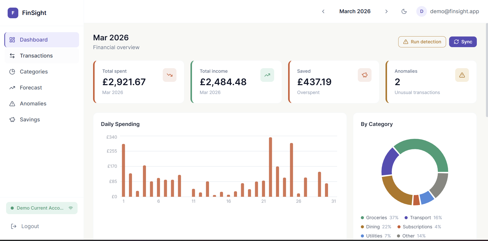
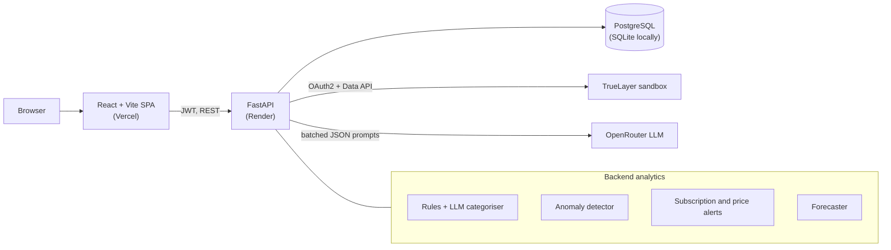
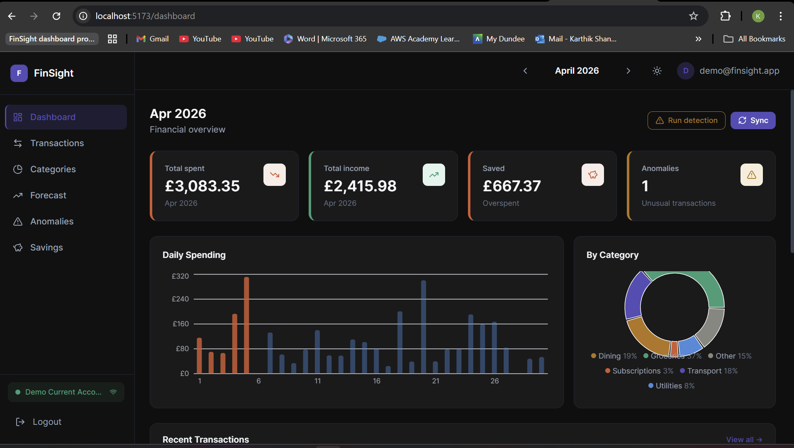
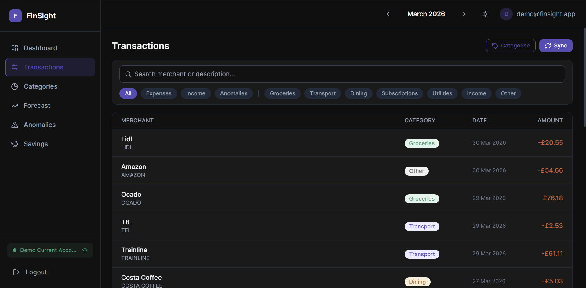
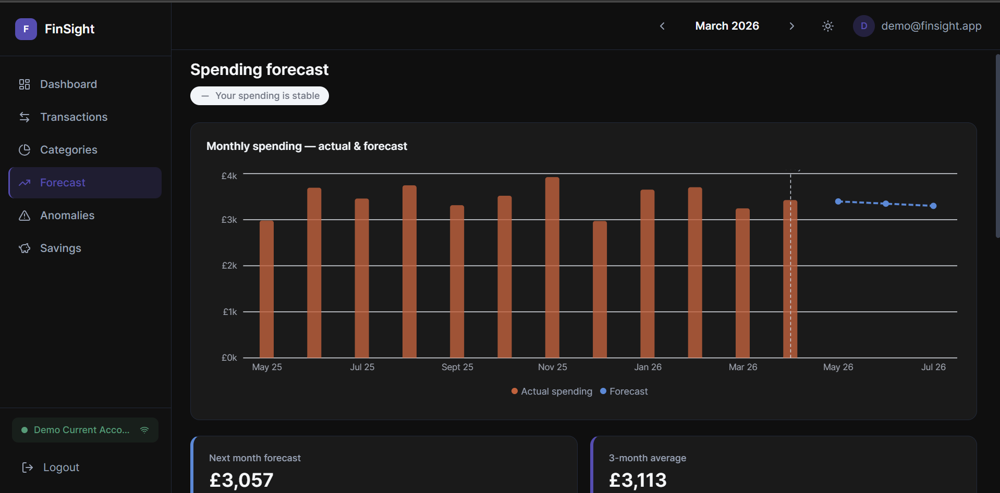
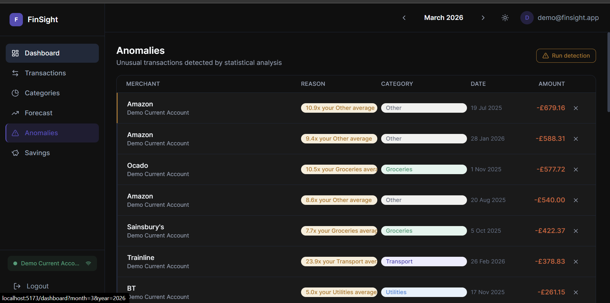
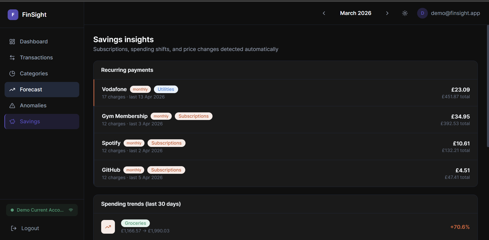
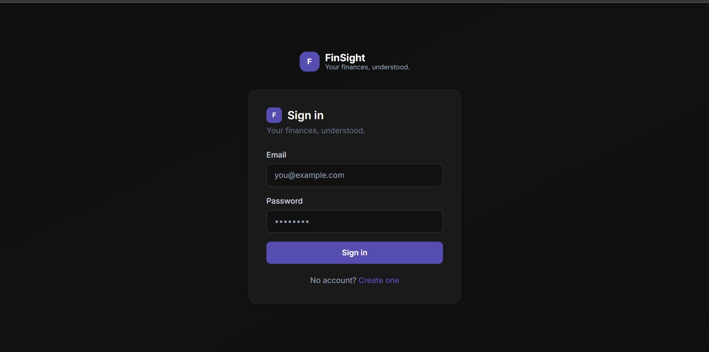

# FinSight

[](https://github.com/botuser11/FinSight/actions/workflows/ci.yml)

**A personal finance dashboard that connects to UK bank accounts, sorts every transaction with rules and an LLM, and tells you what's unusual, recurring and coming next.**

**Live demo:** https://fin-sight-flax.vercel.app. Click **Try the demo** (or sign in with `demo@finsight.app` / `demo1234`).

> The API runs on Render's free tier and sleeps when idle, so the first request can take 30–60 seconds. The app shows a "waking up the server" notice while that happens.

<!-- DEMO GIF: replace with screenshots/demo.gif once recorded -->


## Features

- **Open Banking (sandbox)**: connect a bank through TrueLayer OAuth2; tokens are encrypted at rest and refreshed automatically
- **AI categorisation**: keyword rules first, then unknown merchants go to an LLM via OpenRouter in batches of 25 with JSON output, cached per merchant and capped per user per day
- **Anomaly detection**: per-merchant robust statistics (median/MAD) with a minimum history, so £3 bus fares and £60 fuel stops never skew each other
- **Subscriptions and price alerts**: recurring charges need a regular monthly/weekly cadence and a stable amount; price rises are flagged
- **Spending forecast**: exponential smoothing with trend adjustment
- **Categories**: spend by category with one-click reassignment
- **Dark/light mode**, JWT auth, rate-limited login and a self-refreshing demo account

> **Sandbox banking only.** Bank connections use TrueLayer's sandbox (mock bank) by default. No real bank data is used in the demo.

## Architecture



## Tech stack

| Layer | Technology |
|-------|-----------|
| Frontend | React 18, Vite, Tailwind CSS, Recharts |
| Backend | FastAPI, SQLAlchemy 2, slowapi, Pydantic |
| Database | PostgreSQL (production), SQLite (local/tests) |
| Auth | JWT (python-jose), bcrypt |
| Open Banking | TrueLayer Data API |
| LLM | OpenRouter (model set by `LLM_MODEL`) |
| Quality | pytest, GitHub Actions |
| Hosting | Vercel (frontend), Render (backend) |

## Screenshots

| Dashboard (dark) | Transactions |
|---|---|
|  |  |
| **Forecast** | **Anomalies** |
|  |  |
| **Savings insights** | **Login** |
|  |  |

## Local setup

Prerequisites: Python 3.11, Node.js 18+. TrueLayer sandbox and OpenRouter accounts are optional; without them, bank connect and AI categorisation are disabled and everything else works.

### Backend

```bash
cd backend
cp .env.example .env        # every variable is documented in this file
pip install -r requirements-dev.txt
uvicorn main:app --reload   # creates tables and seeds the demo user on startup
```

### Frontend

```bash
cd frontend
cp .env.example .env        # VITE_API_URL=http://localhost:8000
npm install
npm run dev
```

Open http://localhost:5173 and click **Try the demo**.

### Tests

```bash
cd backend
pytest
```

## Configuration

See [`backend/.env.example`](backend/.env.example). In production (`ENVIRONMENT=production`, or automatically on Render) the API refuses to start without `SECRET_KEY` and `FRONTEND_URL`. Bank connect needs `TOKEN_ENCRYPTION_KEY`; AI categorisation needs `OPENROUTER_API_KEY` and uses `LLM_MODEL`.

## License

[MIT](LICENSE)
